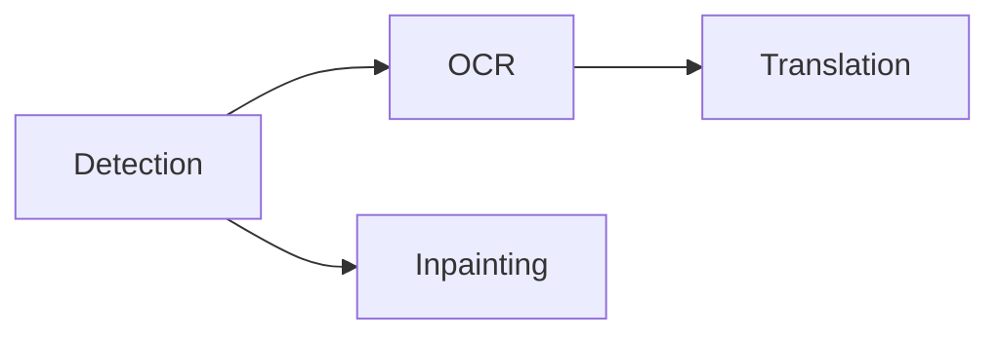

The processing selector above the canvas controls the page scope and stages. Start with the smallest scope that covers the work.

## Choose a scope

<Tabs>
  <Tab title='Current page'>Process the page currently shown on the canvas.</Tab>
  <Tab title='Selected pages'>Process the pages selected in the page rail.</Tab>
  <Tab title='Entire project'>Process every page in project order.</Tab>
  <Tab title='Selected layers'>
    Choose **Process → Process Selected Layers** after editing or adding a few text elements. It
    runs OCR and translation on the selected layers only.
  </Tab>
</Tabs>

## Choose stages

Select any non-empty set of stages, then choose **Run**. Selected stages follow this dependency order:

Detection creates regions and removal masks. OCR reads those regions. Translation writes target text. Inpainting reconstructs artwork under the lettering.

Translation sends pages in batches chosen in **Settings → Translation → Batching**: **Auto** sizes each request to the model, **All pages** and **Halving** send every page of the run together, and **Custom** sends a fixed number per request. A batch starts once OCR has finished on all of its pages, and each page still commits as its own undo step.

<Note>
  Omitted prerequisites are not added automatically. Include detection or OCR when a later stage
  needs fresh input. **Run Inpainting** means detection plus inpainting; it does not include OCR or
  translation.
</Note>

The **Process** menu also offers **Process Project**, **Process Selected Pages**, and **Run Detection**, **Run OCR**, **Run Translation**, and **Run Inpainting**. A **Run** item runs every stage up to the named one and always covers the entire project, regardless of the scope selector.

## Follow progress and stop work

Choose **Run** again to start another job while earlier ones are still running. Jobs take turns at each stage, also with jobs in other windows, so their pages interleave stage by stage, and translation with a hosted provider does not wait for local models on the GPU. A window cannot import pages while one of its jobs is running. The activity center lists every job of its window in the order it started, with its stage, model, progress, and failures; stop each one there.

Each stage commits when it finishes. Completed work remains available if a later stage fails. Stopping prevents new work from starting. A job still waiting for its turn and a request to a hosted provider end at once; local inference already running on the GPU finishes its current step, and that uncommitted result is discarded.

Stages with no applicable input complete without inference, although the model is still loaded first. A page with no detected text does not need OCR or translation.

<Warning>
  Rerunning a stage does not discard your edits. Detection skips any page that already has a text
  region, so delete the existing regions to detect a page again. OCR and translation replace
  generated text but keep source text and translations you edited. Inpainting skips a page that
  already has a cleanup layer unless you paint a new **Remove** mask.
</Warning>

Continue with [text review](/guides/review) or [cleanup](/guides/cleanup).
