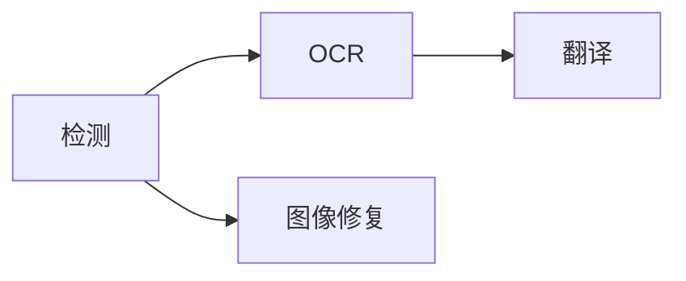

画布上方的处理选择器控制页面范围与阶段。从能覆盖任务的最小范围开始。

## 选择范围

<Tabs>
  <Tab title='当前页面'>只处理画布正在显示的页面。</Tab>
  <Tab title='选中页面'>处理页面栏中选择的页面。</Tab>
  <Tab title='整个项目'>按项目顺序处理全部页面。</Tab>
  <Tab title='选中图层'>
    修正或新增少量文字后，选择**处理 → 处理所选图层**。它只对选中的图层运行 OCR 和翻译。
  </Tab>
</Tabs>

## 选择阶段

选择至少一个阶段，再点击**运行**。已选阶段遵循以下依赖顺序：

检测创建区域与移除蒙版，OCR 读取区域，翻译写入目标文本，图像修复重建原文字迹下方的画面。

翻译按**设置 → 翻译 → 批处理**中选择的方式成批发送页面：**自动**根据模型确定每个请求的大小，**所有页面**和**对半拆分**会一起发送本次运行的所有页面，**自定义**每个请求发送固定数量的页面。一批页面全部完成 OCR 后才开始翻译，每页的结果仍是独立的撤销步骤。

<Note>
  省略的前置阶段不会自动补上。后续阶段需要新输入时，请同时选择检测或
  OCR。**运行修补**只包含检测和图像修复，不包含 OCR 与翻译。
</Note>

**处理**菜单也提供**处理项目**、**处理所选页面**，以及**运行检测**、**运行OCR**、**运行翻译**和**运行修补**。**运行**类菜单项会执行到指定阶段为止的所有阶段，并且始终覆盖整个项目，与范围选择器无关。

## 查看进度与停止

先前的任务仍在运行时，再次点击**运行**即可启动另一个任务。每个阶段一次处理一个任务，各任务（包括其他窗口的任务）轮流使用，因此页面按阶段交替推进；使用托管服务商的翻译不会等待 GPU 上的本地模型。窗口中有任务运行时，该窗口无法导入页面。活动中心按启动顺序列出该窗口的所有任务，显示阶段、模型、进度与错误，并可分别停止。

每个阶段完成后立即提交。后续阶段失败不会移除已完成结果。停止会阻止新工作开始。仍在排队的任务和发往托管服务商的请求会立即结束；GPU 上已在运行的本地推理会先完成当前步骤，其未提交的结果会被丢弃。

没有适用输入的阶段无需推理即可完成，但模型仍会先被加载。未检测到文字的页面不需要 OCR 或翻译。

<Warning>
  重跑阶段不会丢弃你的编辑。检测会跳过已有文字区域的页面，要重新检测请先删除现有区域。OCR
  和翻译会替换生成的文本，但保留你编辑过的原文和译文。图像修复会跳过已有清理图层的页面，除非你绘制了新的**移除**蒙版。
</Warning>

继续[检查文字](/zh/guides/review)或[清理原文](/zh/guides/cleanup)。
